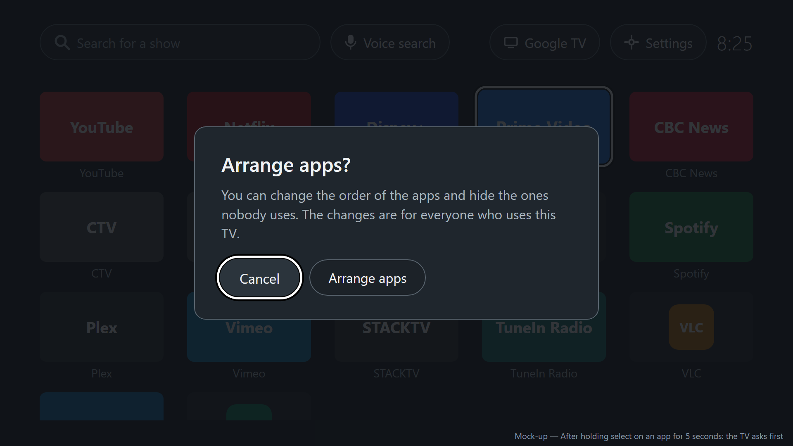
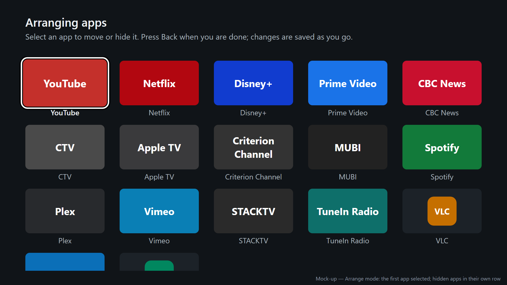
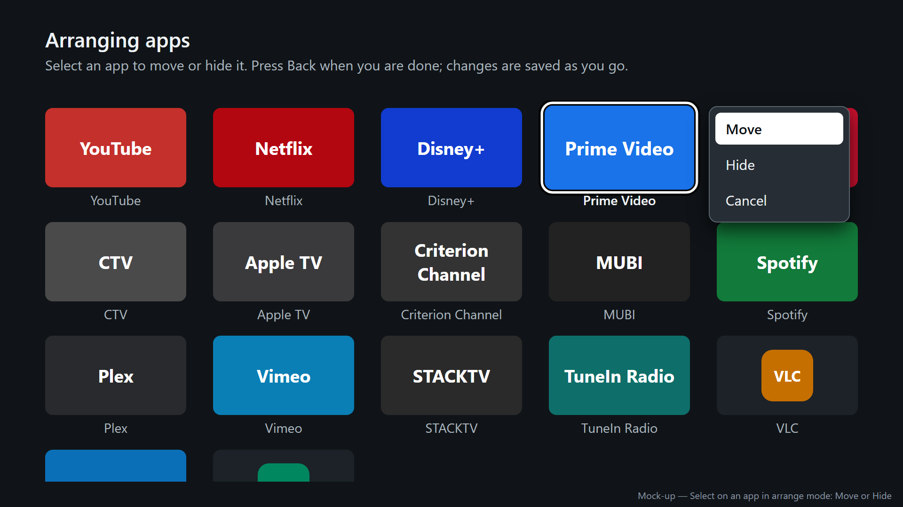
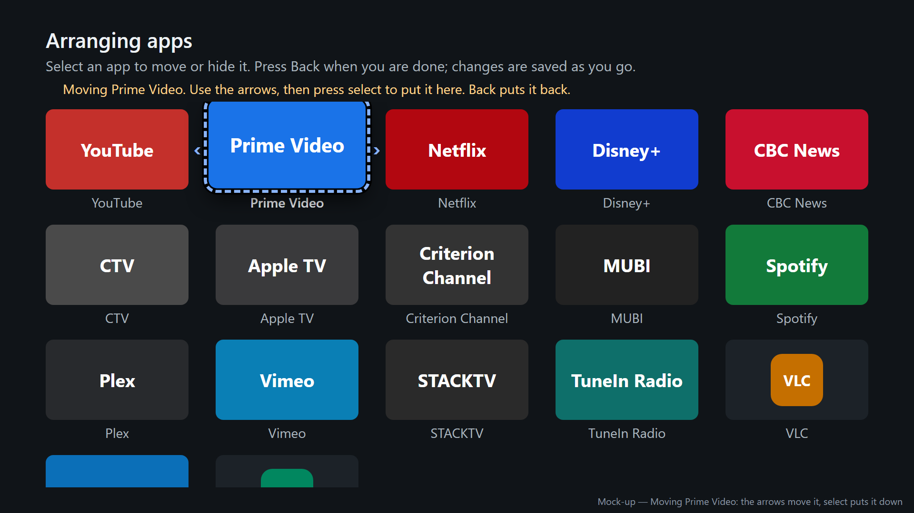
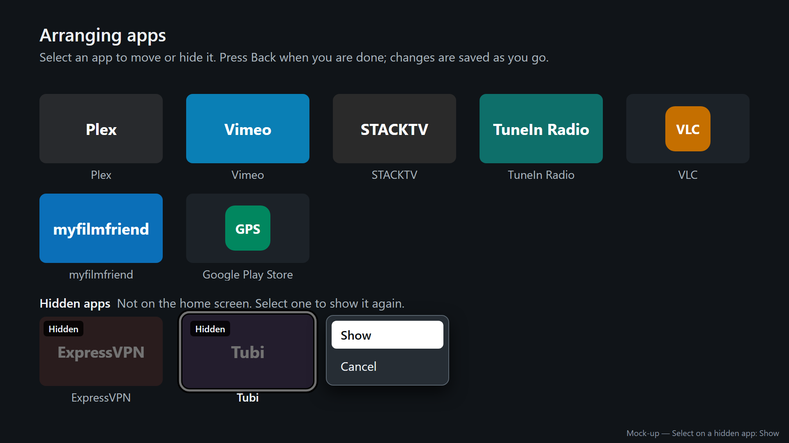
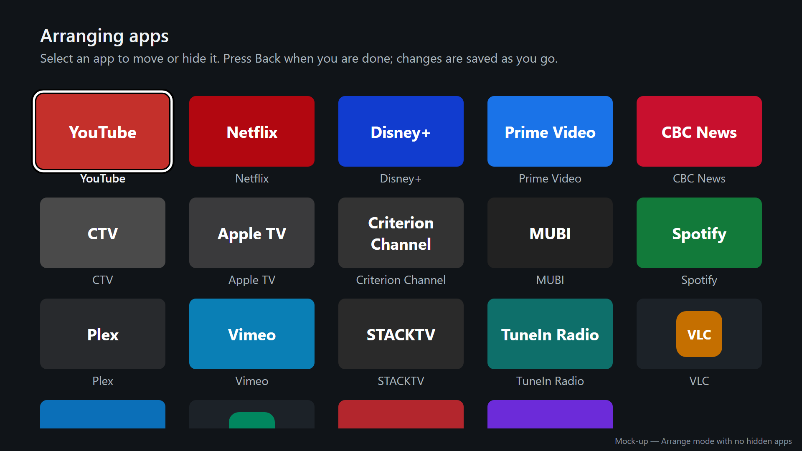

# Arranging the apps: design

<!-- docs/design/arranging.md. Ordering and hiding the household's apps, on the TV and from the PC.
The user documentation (docs/user/arranging.md) is written from this. Mock-ups:
docs/design/arranging/mockup.html (the source), rendered to PNG by render.sh, in the home screen's
look (design-home-screen). The project lead's choices, 2026-11-10: hold select for 5 seconds, then
confirm; hidden apps in a separate row; a text file in Notepad from the PC; all four stories in this
feature. -->

## Personas

- persona-setup-person: puts the household's apps in a sensible order and hides the ones nobody
  uses, on the TV with the remote for a small change, or from the PC for a large one or to put a
  saved order back. Changes are saved as they are made, so nothing is lost by stopping halfway.
- persona-viewer: nothing they do by accident moves or hides an app. The only way in is a 5-second
  hold followed by a question whose first answer is **Cancel**, and arrange mode closes by itself if
  someone walks away from it.

## Flow

On the TV:

1. The set-up person moves to any app on the quiet home screen and holds select. After 5 seconds the
   screen asks **Arrange apps?**, with **Cancel** selected. Letting go before 5 seconds opens the
   app, as a press does.
2. They choose **Arrange apps**. The top row is replaced by **Arranging apps** and a line of
   instructions; the apps are as they are on the home screen, with the first app selected, and below
   them is the **Hidden apps** row.
3. To move an app: select it, choose **Move**, use the arrows to carry it to its new place, and press
   select to put it down there. Back while moving puts it back where it was.
4. To hide an app: select it and choose **Hide**. It moves to the end of the **Hidden apps** row.
5. To show a hidden app: move down to the **Hidden apps** row, select it, and choose **Show**. It
   comes back at the end of the apps.
6. Press Back (or Home) when done. The quiet home screen shows the new arrangement. Each change was
   saved when it was made.

From the PC:

1. The set-up person double-clicks **Arrange apps** (`quiet-arrange.cmd`) in the Quiet Launcher
   folder, or runs `.\quiet-arrange.ps1` in PowerShell.
2. The script connects to the TV as setup does, reads the current arrangement, saves it to
   `arrangement-<serial>.txt` in Documents\QuietLauncher, and opens it in Notepad.
3. They move lines up or down, move a line below **Hidden:** to hide that app, or above it to show
   it, then save and close Notepad.
4. The script sends the file to the TV, checks that the TV has it, and says how many apps are shown
   and hidden. The next press of Home shows it.
5. To put a saved arrangement back (after undo and setup, say): `.\quiet-arrange.ps1 -File <file>`
   sends that file without opening Notepad.

## Mock-ups

Checked against the quiet home screen as built (2026-11-10) on a Chromecast with Google TV (Android
14). The apps are the reference device's, arranged as a set-up person might: Prime Video and CBC
News moved up, ExpressVPN and Tubi hidden. Tiles are placeholders for each app's banner.

| Screen or state | Mock-up | Notes |
|---|---|---|
| Asking first |  | After holding select on an app for 5 seconds. **Cancel** is selected |
| Arrange mode |  | First app selected; the **Hidden apps** row is below the last row of apps |
| Menu on an app |  | Select on an app; **Move** is selected |
| Moving an app |  | Prime Video carried from fourth to second place; the status line says what the keys do |
| Menu on a hidden app |  | The grid has scrolled to the **Hidden apps** row |
| No hidden apps |  | The row says how to hide one |

The PC script's output (PowerShell; text in angle brackets varies):

```
PS> .\quiet-arrange.ps1
Quiet Launcher: arrange apps

[1/3] TV: connected to 10.0.0.202:34447
[2/3] Arrangement: opened in Notepad (Documents\QuietLauncher\arrangement-<serial>.txt)
      Move lines to change the order; move a line below "Hidden:" to hide that app.
      Save and close Notepad when you are done.
[3/3] Sent to the TV: 17 apps shown, 2 hidden. Press Home to see it.

Done. Log: Documents\QuietLauncher\arrange-<date>.log
```

```
[3/3] Nothing changed.
```

```
[3/3] Skipped 1 line that is not an app on this TV: "Hulu"
      Sent to the TV: 17 apps shown, 2 hidden. Press Home to see it.
```

The file, as Notepad shows it:

```
# Quiet Launcher: the order of the apps on the home screen, one per line.
# Move lines to change the order. Apps below "Hidden:" are not on the home screen.
# Save and close Notepad when you are done. Lines starting with # are ignored.
YouTube
Netflix
Disney+
Prime Video
CBC News
...
Google Play Store

Hidden:
ExpressVPN
Tubi
```

## Layout

- **Asking first**: a panel centred on the dimmed home screen, titled **Arrange apps?**, with
  **You can change the order of the apps and hide the ones nobody uses. The changes are for
  everyone who uses this TV.** and two buttons, **Cancel** (selected) and **Arrange apps**. Back
  is the same as **Cancel**.
- **Arrange mode** replaces the top row with the heading **Arranging apps** and the line **Select an
  app to move or hide it. Press Back when you are done; changes are saved as you go.** The status
  line is under it, as on the home screen. The search box, **Voice search**, **Google TV**,
  **Settings**, and the clock are not shown, so nothing else can be started from arrange mode.
- **Apps** are in the same grid as the home screen (five per row, the same tiles and selection
  look), followed by the **Hidden apps** label with **Not on the home screen. Select one to show it
  again.**, and then the hidden apps' row, their banners darkened and marked **Hidden**. With no
  hidden apps, the row says **No hidden apps. To hide one, select it and choose Hide.** Movement is
  the home screen's (no wrapping); Down from the last row of apps goes to the **Hidden apps** row.
- **Menu**: beside the selected app, a short list: **Move**, **Hide**, **Cancel** on an app;
  **Show**, **Cancel** on a hidden app. The first item is selected. Back closes it.
- **Moving**: the app is lifted (enlarged, with a dashed blue outline and arrows at its sides) and
  the status line says **Moving <app>. Use the arrows, then press select to put it here. Back puts it
  back.** Left and right move it one place in the list, across the end of a row to the next or
  previous row; up and down move it five places (a row), stopping at the first and last places. The
  other apps shift to make room as it moves. It cannot be moved into the **Hidden apps** row.
- **Names**: **Arrange apps**, **Arranging apps**, **Move**, **Hide**, **Show**, **Cancel**,
  **Hidden apps**, **Hidden**. The PC script is **Arrange apps** (`quiet-arrange.cmd`, beside
  `quiet-setup.cmd` and `quiet-undo.cmd`), and its file is the arrangement file.

## States and errors

- **Holding select**: nothing shows during the 5 seconds [assumed: no hint, so a viewer holding
  select out of habit only sees their app open]. The app opens if select is let go first.
- **Leaving arrange mode**: Back (with no menu open and nothing being moved), Home, or 2 minutes
  with no button pressed [assumed]. If an app is being moved when it times out, it is put back where
  it was. The home screen then shows the top, with the first app selected.
- **The last app on the home screen** cannot be hidden, because arrange mode is reached by holding
  select on an app: its menu has no **Hide**, and the status line says **Keep at least one app on
  the home screen.**
- **An app is installed while arranging**: it appears at the end of the apps. **An app is removed**:
  it leaves the list, and the rest keep their order. If it was being moved, moving stops.
- **The PC sends an arrangement while arrange mode is open**: arrange mode closes and the home screen
  shows the new arrangement (the last change wins).
- **PC: the TV is not reachable**, **more than one device**, **ADB not found**: the same messages as
  setup (design-setup, Errors), and nothing is changed.
- **PC: the app is not installed**: **[1/3] TV: the quiet home screen is not set up on this TV. Run
  quiet-setup first.** and nothing is changed.
- **PC: a line that is not an app on the TV** (a typo, or an app since removed): skipped, and named.
  Two apps with the same name are told apart in the file by their package name in brackets after
  the name, for example `YouTube (com.google.android.youtube.tv)`.
- **PC: an app missing from the file**: it stays shown, at the end.
- **PC: Notepad closed without saving, or no change**: **Nothing changed.**
- **PC: the file has no lines above "Hidden:"**: **The file hides every app; keep at least one above
  "Hidden:".** and nothing is sent.

## How it works

- **What is stored**: one small file in the app's own storage on the TV: the arranged apps' package
  names in order, and the hidden ones. Nothing is stored per profile, so every profile sees the same
  arrangement. It survives restarts and updates of the app and of the TV's system; uninstalling the
  app (undo) or resetting the TV deletes it, which is why the PC keeps its own copy.
- **Building the list**: the installed apps (as now, design-home-screen, How it works) in the stored
  order, then any apps not in it (newly installed ones) in install order, with the hidden ones left
  out of the home screen. Before anything is arranged, the order is as now: install order, the Play
  Store last. Once arranged, the Play Store is wherever the set-up person put it, and new apps go
  after it.
- **Holding select**: the home screen times how long select has been held on an app tile. At 5
  seconds it shows the question and ignores the rest of that hold; letting go earlier opens the app.
  This replaces Android's own long press (about half a second), which the home screen does not use.
- **From the PC**: the app has a receiver that only ADB's shell can call (it requires a permission
  that the shell has and that apps cannot be given, `android.permission.DUMP`) [to validate on the
  reference device]. The script asks it for the current arrangement (each app's name, package, and
  whether it is hidden, in order) with `adb shell am broadcast`, reading the reply from the
  broadcast's result [to validate], and sends the new one the same way, as base64 text so the names
  need no quoting. The receiver saves it and tells the home screen, which redraws.
- **The launchers**: `quiet-arrange.cmd`, like `quiet-setup.cmd` and `quiet-undo.cmd` (the project
  lead's request, 2026-11-10), runs the script with PowerShell's execution policy bypassed for that
  run only, and keeps the window open at the end so the result can be read.

## Accessibility

- Everything works with the direction pad, select, and back. The hold is the only timed action, and
  the PC script does everything it does without one.
- Contrast: the heading and instructions are the home screen's text colours (8.8:1 and above); the
  moving outline `#8ab4f8` is 8.6:1 on the background, with a black edge outside it; hidden apps'
  names stay in the muted text colour (8.8:1) while their banners are darkened, and the **Hidden**
  badge is white on black.
- With TalkBack on:
  - Entering arrange mode is announced: "Arranging apps. Select an app to move or hide it. Press
    Back when you are done."
  - Each app reads its name, "app", and its place ("3 of 17"); a hidden app reads "<name>, hidden
    app".
  - While moving, each step is announced: "Prime Video, 2 of 17". Putting it down: "Prime Video
    placed, 2 of 17". Back: "Prime Video put back, 4 of 17".
  - Hiding and showing are announced: "Tubi hidden", "Tubi shown, 18 of 18".
  - Holding select with TalkBack on [to validate]: TalkBack may use the select key itself; the PC
    script is the way in if it does.
- With "remove animations" on, the moving app jumps from place to place and nothing slides.
