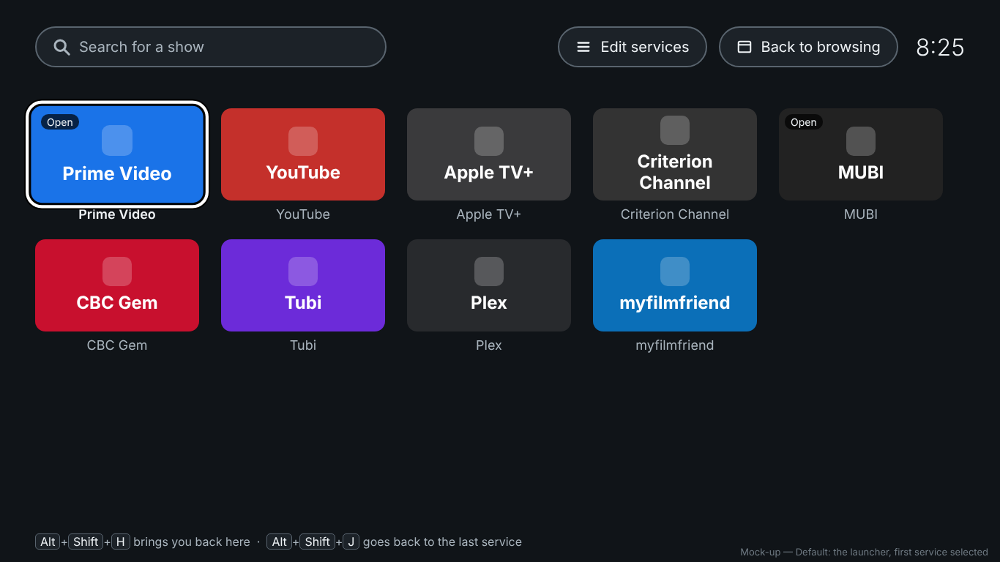
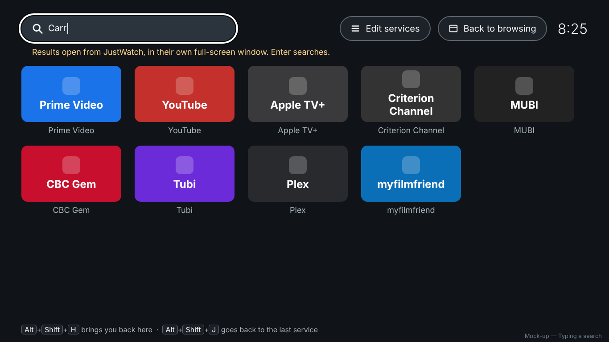
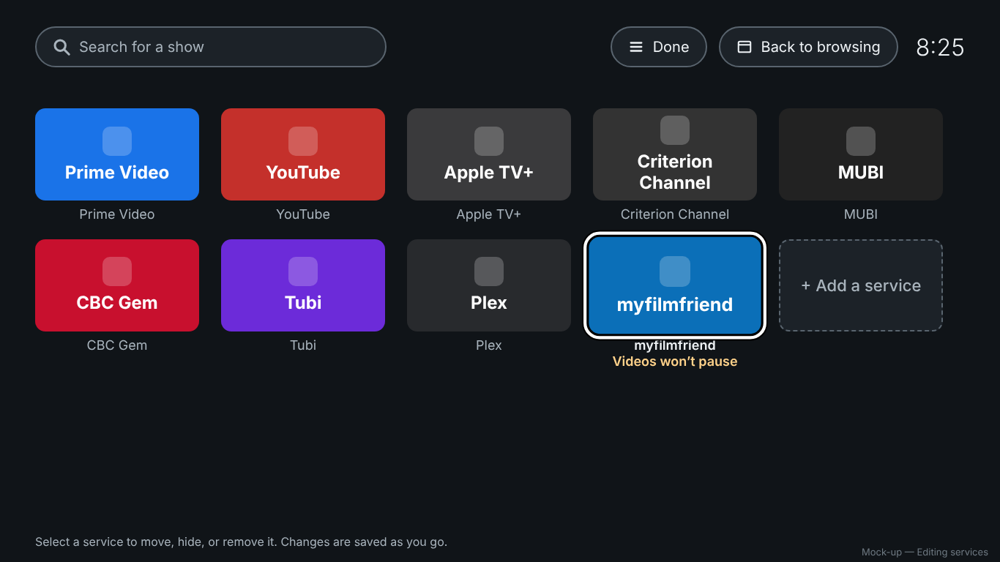
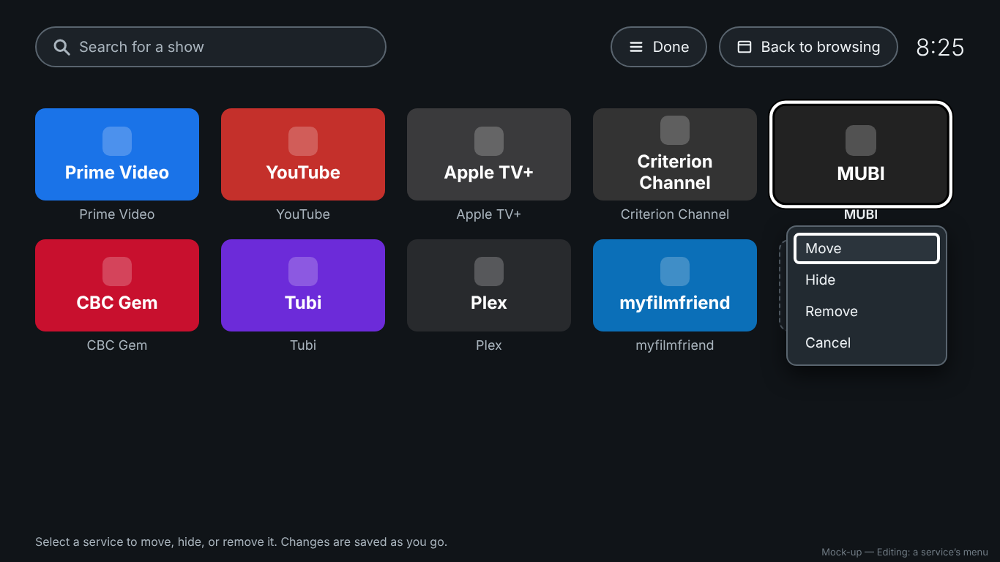
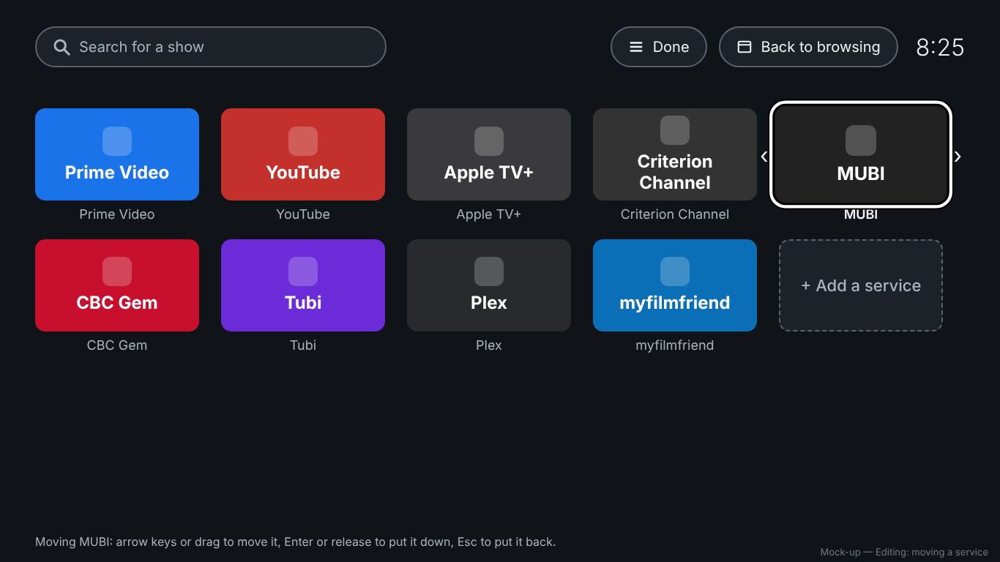
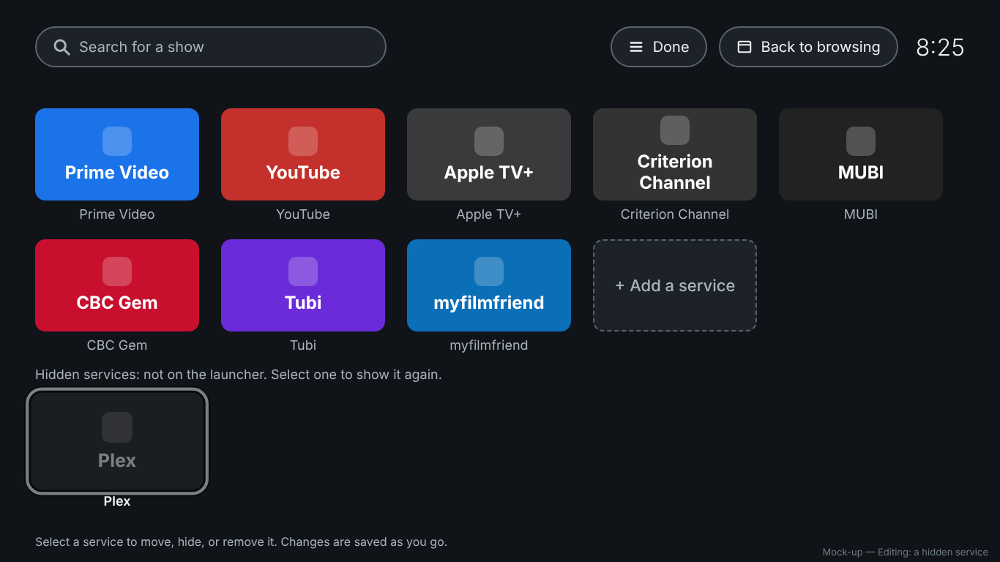
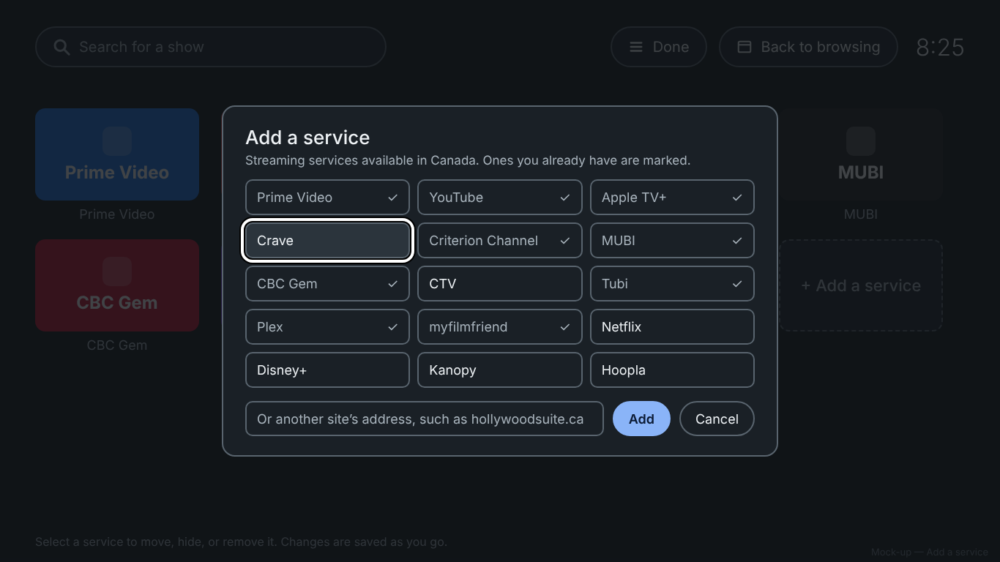
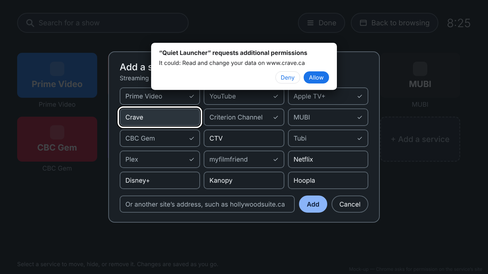
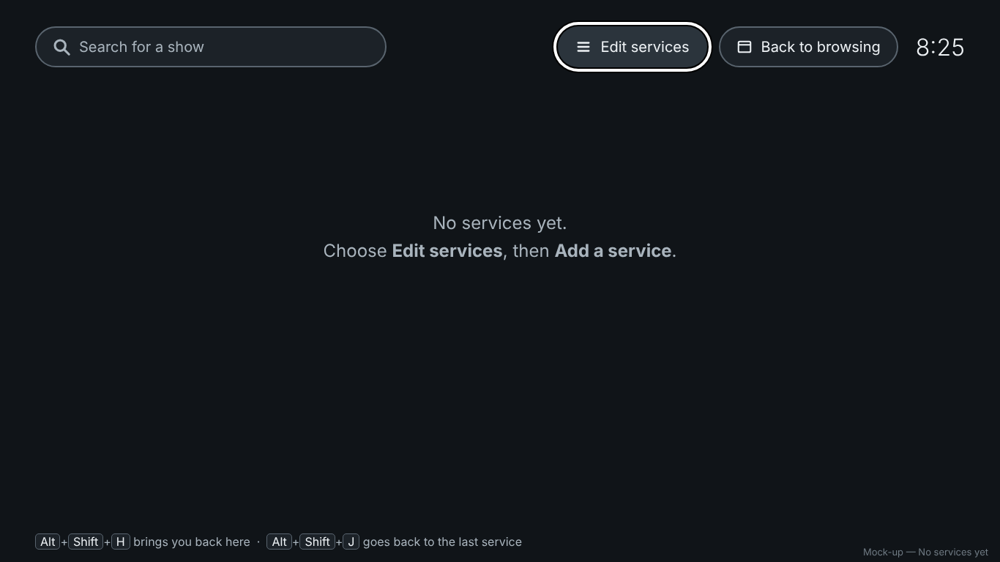

# Chromebook launcher design

<!-- docs/design/chromebook.md. The launcher on the project lead's Chromebook, a Chrome extension.
Mock-ups: docs/design/chromebook/mockup.html (the source), rendered to PNG by render.js. It
follows design-home-screen's look and wording where the two do the same thing. Drafted
2026-11-17; the agent's choices that go beyond the approved stories are marked [proposed] until
the project lead accepts them. Still to add: a touchscreen way back to the launcher in tablet mode
(the project lead's request, 2026-11-17), after a spike. -->

## Personas

- persona-chromebook-viewer: answers their goals of one place for every service, full screen with
  nothing of the browser showing, and finding which service has a title, and their frustrations of
  scattered sites, the flash of tabs, and videos playing on. **Back to browsing** and leaving
  Chrome's new tab page alone keep Chrome a browser.

## Flow

1. From anywhere in Chrome, the viewer presses Alt+Shift+H. The launcher appears in its own
   full-screen window, with the first service selected; if it was already open, it comes forward
   as it was.
2. To watch: choose a service (click, tap, or move to it with the arrow keys and press Enter). It
   opens in its own full-screen window, or, if already open, comes back as it was left.
3. To go back: Alt+Shift+H from the service. The launcher comes forward and the service's video
   pauses. Alt+Shift+J from the launcher goes straight back to the last service.
4. To search: type in **Search for a show** and press Enter. JustWatch's results for Canada open
   in their own full-screen window. Following a link to one of the viewer's services turns that
   window into the service's window.
5. To change the services: **Edit services**. Select a service to move, hide, or remove it; **Add a
   service** to add one. **Done** returns to the launcher.
6. To stop watching: **Back to browsing** brings forward the Chrome window the viewer was last
   browsing in [proposed]. The launcher and the services stay open behind it, ready for
   Alt+Shift+H.

## Mock-ups

Drawn at 1366 by 768, a common Chromebook screen size. The services are the project lead's (2026-11-17).
The tiles are placeholders: the real launcher shows each service's name on its colour with the
site's own icon. Chrome's permission prompt is Chrome's own; the mock-up only marks where it
appears.

| Screen or state | Mock-up | Notes |
|---|---|---|
| Default, first service selected |  | **Open** marks services whose window is open [proposed] |
| Typing a search |  | The status line says where results open |
| Editing |  | **Add a service** is the last tile; a service without permission says so |
| A service's menu |  | **Move**, **Hide**, **Remove**, **Cancel** |
| Moving a service |  | Arrow keys or drag; Enter or release puts it down; Esc puts it back |
| A hidden service |  | Hidden services are listed after the others while editing |
| Add a service |  | A list of services in Canada, or another site's address |
| Chrome asks for permission |  | Chrome's own prompt, on adding a service |
| No services |  | **Edit services** is selected |
| A shortcut is taken |  | The status line says what to do |
| Selected service already open |  | Choosing it brings its window back |

## Layout

- Full screen, at any Chromebook screen size; the mock-ups are at 1366 by 768. Dark, plain
  background, the TV's colours. Nothing moves or changes on its own apart from the clock and the
  status line.
- **Top row**, left to right: **Search for a show** (a search box with a magnifier), **Edit
  services** (which reads **Done** while editing), **Back to browsing**, and the clock, which
  cannot be selected. Each control has a visible edge (`#59646e`, at least 3:1), as on the TV.
- **Status line**: reserved space under the top row, empty unless there is something to say, so a
  message never moves the services.
- **Services**: a grid, five per row at 1366 px wide and as many as fit at other widths, each a
  rounded tile with the service's site icon above its name on the service's colour, and the name
  again underneath, as on the TV. In the viewer's order, hidden ones left out. A service whose
  window is open has a small **Open** marker [proposed]. A service that cannot be paused (its site
  permission was refused) says **Videos won't pause** under its name.
- **Hint line** at the bottom: the shortcuts in use, read from Chrome, for example **Alt+Shift+H
  brings you back here · Alt+Shift+J goes back to the last service** [proposed]. While editing, it
  says how editing works instead.
- **Selection**, as on the TV: a white outline with a thin black edge, slightly enlarged, the name
  white and bold. One item is selected at all times while the keyboard is in use; a click or tap
  selects and activates in one step.
- **Movement**: the arrow keys move between neighbours, as on the TV, with no wrapping; Tab and
  Shift+Tab move through everything in reading order; Enter or Space activates. Up from the first
  row goes to the top row.

## Editing

- **Edit services** turns the grid into an editing grid: the services, then **Add a service**, then
  any hidden services under **Hidden services: not on the launcher. Select one to show it again.**
- Selecting a service opens its menu: **Move**, **Hide** (or **Show** for a hidden one),
  **Remove**, **Cancel**. Esc closes the menu.
- **Move** lifts the service. The arrow keys move it one place at a time, or it can be dragged with
  the touchpad or a finger. Enter, or releasing a drag, puts it down; Esc puts it back where it was.
- **Remove** asks **Remove <name>? Its window will close.** with **Remove** and **Cancel**, since a
  removed service has to be added again from the list.
- **Add a service** opens a panel with the streaming services available in Canada [proposed: the
  list in the mock-up, kept in the extension and updated with it], those already added marked, and
  a field for any other site's address. Choosing one asks Chrome for permission on its site.
  Allowed or refused, the service is added at the end; refused, it shows **Videos won't pause**,
  and selecting that text explains how to allow it later.
- Every change is saved at once. **Done**, or Esc with nothing lifted or open, ends editing. No
  step guards editing: one person uses the Chromebook.

## States and errors

- **Searching**: Enter with text opens JustWatch's results in their own full-screen window, and
  the box is cleared. Enter with nothing typed does nothing. The status line, while the box is
  selected, says **Results open from JustWatch, in their own full-screen window. Enter searches.**
  [proposed]
- **No services**: **No services yet. Choose Edit services, then Add a service.** with **Edit
  services** selected.
- **A shortcut is taken**: if Chrome could not give the extension Alt+Shift+H or Alt+Shift+J
  because something else uses it, the status line says so and names
  `chrome://extensions/shortcuts`, and the hint line leaves that shortcut out until one is set.
- **A service's window was closed** by the viewer: choosing the service opens it again.
- **The launcher's window was closed**: Alt+Shift+H opens a new one.
- **Leaving full screen** with the Chromebook's full-screen key works in any of these windows, as
  it does in Chrome; Alt+Shift+H and choosing a service put their window back in full screen.
- **A video that will not stay paused**: if a service's player starts again by itself, that is
  what the viewer sees; the launcher does not fight it.

## How it works

- **An extension, not a page**: a Chrome extension (Manifest V3) with a background service worker.
  It does not replace the new tab page. It has no content of its own beyond its pages, and fetches
  nothing: the service icons come from Chrome's own icon cache (the `favicon` permission).
- **The shortcuts**: two extension commands, `go-home` (suggested Alt+Shift+H) and `go-last`
  (suggested Alt+Shift+J), which work from any Chrome window; the spike confirmed both are free on
  the project lead's Chromebook.
- **Windows**: the launcher and each service are `popup` windows created full screen, so none has
  a tab strip; the spike showed switching windows never flashes Chrome's tabs or address bar. The
  service worker keeps a map from service to window in session storage, so it survives the worker
  sleeping; a window that closes is dropped from the map.
- **Going back pauses**: on `go-home`, before bringing the launcher forward, the worker runs a
  script in every frame of the service's window that pauses each playing `<video>`, as the spike
  did on Prime Video. It needs host permission on the service's site, requested as an optional
  permission when the service is added.
- **Search**: JustWatch's search for Canada (`https://www.justwatch.com/ca/search?q=<text>`), in a
  new full-screen popup window. When that window navigates to one of the viewer's services, the
  worker records it as that service's window (replacing any earlier one in the map, which stays
  open).
- **Storage**: the services, their order, hidden services, and colours in `chrome.storage.local`,
  which stays on the Chromebook; nothing per window is stored beyond the session.
- **Install and removal**: loaded unpacked from the repository's extension folder, following
  written steps in the user documentation. Removing the extension closes its windows and deletes
  its storage, which Chrome does for any removed extension.

## Accessibility

- Everything works with the keyboard alone, with the touchpad, and with the touchscreen; nothing
  needs a hover.
- The TV's colours and contrast: muted text on the background 8.8:1, status text 13:1, the white
  selection outline at least 12:1.
- Text is at least 18 px and follows Chrome's zoom and ChromeOS's text size; names wrap to two lines
  before being shortened.
- With ChromeVox: each tile reads the service's name, "button", and **Open** or **Videos won't
  pause** when shown; the controls read their names; the status line is announced when it changes;
  editing announces "Editing services" and each move ("MUBI, moved to 4 of 9").
- With ChromeOS's reduce-motion setting on, nothing animates: no enlarging, and lifted services move
  without sliding.
