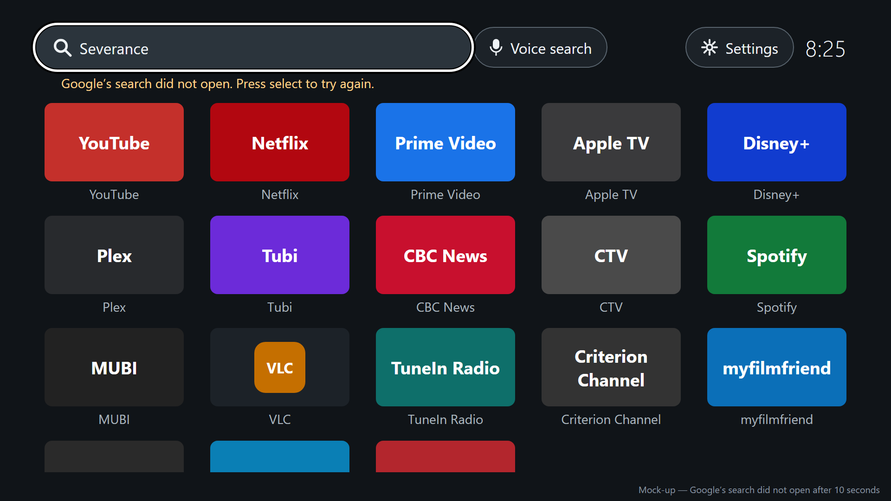
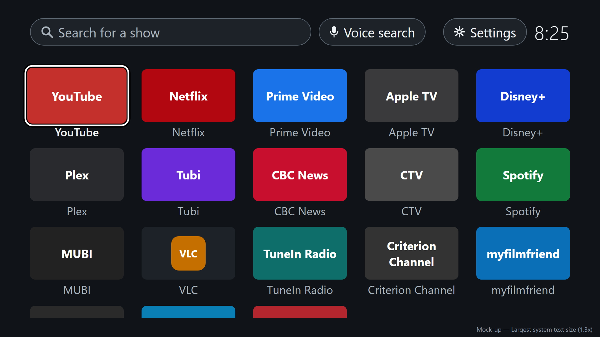

# Home screen design

<!-- docs/design/home-screen.md. The quiet home screen and the search that starts from it. The user
documentation is written from this. Mock-ups: docs/design/home-screen/mockup.html (the source),
rendered to PNG by render.sh. Revised 2026-11-09 after a persona walkthrough, a UX review, and an
accessibility review. -->

## Personas

- persona-viewer: answers their goals of opening their usual app straight away and finding which
  app has a show, and their frustrations of buried apps, promotion, and having to call the project
  lead over. Every item has a visible name and the screen never changes on its own, so a guest
  needs no explanation. The apps are in install order, not the order Google TV shows today, so
  they will be in new places at first; arranging comes in the second release (the project lead's
  decision, 2026-11-09).
- persona-setup-person: **Settings** is in the top row, and new apps appear without their help.

## Flow

1. The viewer presses Home, from anywhere. The quiet home screen appears, scrolled to the top, with
   the first app selected.
2. To open an app: move to it with the direction pad and press select.
3. To search: move up to **Search for a show**, press select, type with the TV's keyboard, and press
   its **Search** key. The screen shows **Searching for "…"** until Google's search screen opens;
   Google then dims the screen and shows the text while it finds the page, and its page for the
   show appears, naming where to watch it.
4. Back from Google's page or chat reply returns to the quiet home screen, with **Search for a
   show** selected and empty.
5. **Voice search** starts Google's voice search; Back returns with **Voice search** selected. The
   remote's own voice button works as it always has. [to validate]
6. **Settings** opens the TV's settings. Back or Home returns to the quiet home screen.

## Mock-ups

Checked against Google TV on a Chromecast with Google TV (Android 14, Cast firmware 3.72). The
keyboard is the TV's own (Gboard for TV); the mock-up only marks where it appears and that the box
asks for a **Search** key. The tiles are placeholders that show each app's name in a colour; the
real screen shows each app's own banner artwork (VLC shows the icon case). The apps are the
reference device's 18, in a stand-in install order.

| Screen or state | Mock-up | Notes |
|---|---|---|
| Default, first app selected |  | What Home always shows. The fourth row peeks in at the bottom: there are more apps below |
| Search for a show selected |  | |
| Typing |  | The TV's keyboard covers the lower half; its **Search** key submits |
| Searching |  | From **Search** until Google's search screen opens |
| Search did not open |  | After 10 seconds; the text is kept |
| Voice search selected |  | |
| Settings selected |  | |
| Last row selected |  | The grid has scrolled one row; the first row is hidden completely |
| No internet connection |  | The status line under the top row; nothing moves |
| Largest system text size |  | Text grows; the grid scrolls sooner |
| No apps |  | Unlikely; **Search for a show** is selected |

## Layout

- 1920 by 1080, inside the TV safe area (96 px at the sides, 54 px at the top and bottom). Dark,
  plain background. Nothing on the screen moves or changes on its own, apart from the clock and the
  status line.
- **Top row**, left to right: **Search for a show** (a search box, with a magnifier), **Voice
  search** (with a microphone), **Settings** (with a gear), and the clock. The clock cannot be
  selected. Each control has a visible edge (`#59646e` on the dark background, at least 3:1). The
  top row never scrolls.
- **Status line**: a line of reserved space under the top row, empty unless there is something to
  say (no internet connection, a search that did not open). Because its space is always reserved,
  a message never moves the apps.
- **Apps**: a grid of five per row, each the app's banner (300 by 169) or, if it has no banner, its
  icon centred on a tile of the same size, with the app's full name underneath, on up to two lines
  and cut short with an ellipsis only beyond that. Order: install order, oldest first; apps whose
  install times are identical to the second are in alphabetical order.
- **Which apps**: see How it works. Other home-screen apps (Projectivy Launcher on the reference
  device) are left out (the project lead's decision, 2026-11-09).
- **Selection**: the selected item has a white outline with a black edge outside it (so it shows on
  light and dark artwork alike), is slightly enlarged, and its name turns white and bold. Exactly
  one item is selected at all times.
- **Movement** (no wrapping anywhere):
  - Left and right move to the neighbour in the same row, and do nothing at the ends of a row.
  - Down from the top row goes to the app nearest below the control; Up from the first row of apps
    goes to the top-row control nearest above the app.
  - Up and down between app rows go to the nearest app in that row (in a short last row, the
    nearest one there is). Down from the last row does nothing.
  - The grid scrolls a whole row at a time, and only when the newly selected row would otherwise be
    cut off. A row that scrolls under the top row is hidden completely. The row below the last full
    row peeks in at the bottom as a cue; it cannot be selected until it has scrolled into view.
- **Where selection lands**:
  - Home: always scrolled to the top, first app selected (or **Search for a show** if there are no
    apps). Home on the quiet home screen does the same and leaves it showing.
  - Back from Google's search: **Search for a show**, empty.
  - Back from Google's voice search: **Voice search**.
  - Back from an app opened from the quiet home screen: the app that was opened. [to validate]
- **Back on the quiet home screen does nothing.** The screen never closes, so Back can never reveal
  Google TV's home screen behind it.
- **Sizes** are in Android's scalable units, so they follow the TV's text-size setting. At larger
  sizes the top row and the names grow, and fewer rows fit; nothing is cut off.

## States and errors

- **Typing**: the TV's keyboard. Back closes it and keeps the text; Back again leaves the box. Home
  closes it, clears the text, and goes to the top with the first app selected.
- **Searching**: from pressing **Search** until Google's search screen opens (about half a second;
  [to validate] in the first build), the screen dims and shows **Searching for "<text>"…** and
  **Google's search will open in a moment. Back cancels.** with a spinner. **Search for a show**
  stays selected underneath. Every key except Back and Home is ignored. Back cancels, returning to
  the box with the text kept. When Google's search screen opens, the box is cleared. Once open,
  Google shows the wait itself until its page appears: it dims the screen behind (the quiet home
  screen) and shows the typed text in a glowing box at the bottom, then fades the show's page in
  (checked on the reference device, 2026-11-09).
- **Search did not open**: if Google's search has not opened after 10 seconds, the overlay goes, the
  text is put back in the box, the box stays selected, and the status line says **Google's search
  did not open. Press select to try again.**
- **Empty search**: pressing **Search** with nothing typed keeps the keyboard open and does nothing
  else.
- **Chat reply**: shown by Google as it is. Back returns home, with the box selected and empty, ready
  to try different text.
- **No internet connection**: the status line says **No internet connection. Search and voice search
  need it; your apps still open.** Search and voice search still go to Google, which shows its own
  error. The line clears when the connection returns.
- **No apps**: **No apps to show. Apps installed on this TV appear here.** with **Search for a show**
  selected.
- **An app is installed or removed while the screen is showing**: the grid updates in place; the
  selection stays on the same app, or moves to the next one if the selected app was removed.
- **An app does not open**: nothing changes on the quiet home screen; Android shows its own
  message.

## How it works

- **Which apps, and their artwork**: the apps Android lists as openable from a TV home screen
  (activities for `MAIN` with the `LEANBACK_LAUNCHER` category), minus:
  - this app;
  - any app that is itself a home screen (has an activity for the `HOME` category), such as
    Projectivy Launcher;
  - the four Google system apps that Google TV's own **Your apps** list leaves out: TV settings
    (`com.android.tv.settings`, reached with **Settings** instead), the Play Store
    (`com.android.vending`), Play Games (`com.google.android.play.games`), and Google TV
    (`com.google.android.videos`).

  Checked on the reference device on 2026-11-09: without the home-screen rule this gives the same
  19 apps as Google TV's **Your apps**; with it, 18. Banner, icon, and name come from each app;
  install time comes from Android, so the order survives restarts without storing anything.
- **New and removed apps**: the screen listens for Android's package added and removed broadcasts,
  and also rebuilds the list each time it is shown.
- **"Never shows promotion"**: the app has no internet permission, so it cannot fetch anything; it
  draws only installed apps' own artwork, its own three controls, the clock, and the status line.
  Checked by a test that fails if the built app requests the internet permission, and a screen test
  that the only items are app tiles, the three controls, the clock, and the status line.
- **"Pressing Home never shows Google TV's home screen"**: decision-home-takeover, plus Back doing
  nothing on the quiet home screen. Checked by the screen-recording test in
  story-quiet-home-home-key, and by tests of the service's rule: the Home key is consumed, Google
  TV's home screen window brings the quiet one forward, and no other window or key does anything.
- **Search**: the text is sent unchanged to Google's search (`GLOBAL_SEARCH` with a `query`, as in
  the spike), with the keyboard asking for a Search action key. The box is cleared when Google's
  search screen opens (when the quiet home screen stops being in front), or restored on Back or
  timeout. **Voice search** sends the same request with no text, which opened Google's voice search
  in the spike.
- **Back from Google's search**: Google's screens sit on top of the quiet home screen, so Back
  returns to it (seen in the spike).
- **Settings**: opens the TV's settings app (Android's main settings screen: network, display,
  accounts, and so on).
- **Clock**: the system clock, which follows the TV's time zone and 12- or 24-hour setting. In
  12-hour mode it shows no AM or PM, as Google TV's own clock does.
- **No internet connection**: Android's connectivity status, updated as it changes.
- **Same for every profile**: nothing is stored per profile; the list comes from what is installed.

## Accessibility

- Everything is reachable with the direction pad, select, back, and home; nothing needs a pointer.
- Contrast (from the mock-up's colours): muted text `#a9b4bd` on the background is 8.8:1, the status
  text `#ffd28a` 13:1, and the white selection outline at least 12:1 against the background; the
  black edge outside it keeps it at least 3:1 against any banner.
- Text is at least 28 px at 1080p, in scalable units that follow the TV's text-size setting; names
  are always shown, never only on selection, and wrap to two lines before being shortened.
- With the TV's screen reader (TalkBack) on:
  - Each app tile reads the app's full name and "app", and its position ("row 2, column 3"). Each
    control reads its name and role: "Search for a show, edit box", "Voice search, button",
    "Settings, button". The magnifier, microphone, and gear are decorative and not read.
  - The clock reads the time when reached, and is not announced as it changes.
  - The searching overlay is announced when it appears ("Searching for Severance"); the status line
    is announced when it changes (politely for no internet connection, at once for a search that
    did not open).
  - Pressing **Search** with nothing typed is announced as "Type something to search".
- With the TV's "remove animations" setting on, nothing animates: the selection changes without
  enlarging smoothly, the grid jumps a row, and the searching overlay shows its text without the
  spinner.
