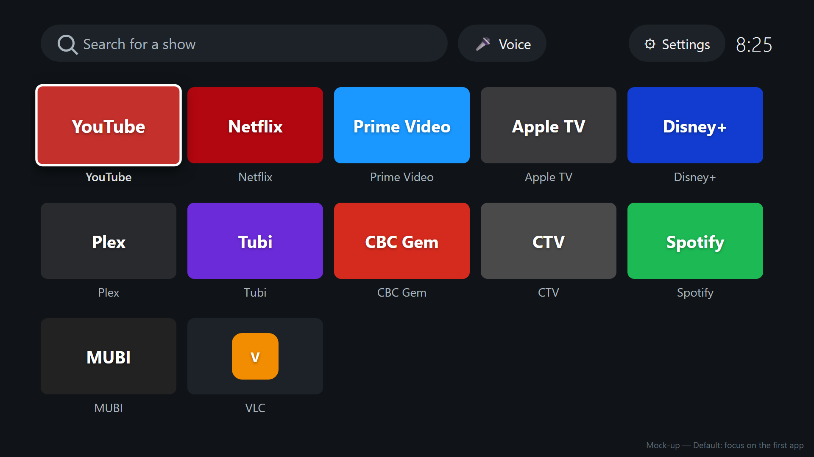
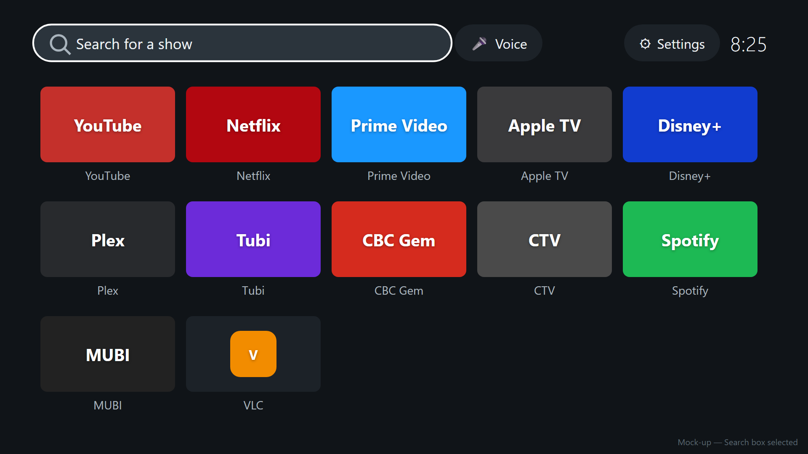
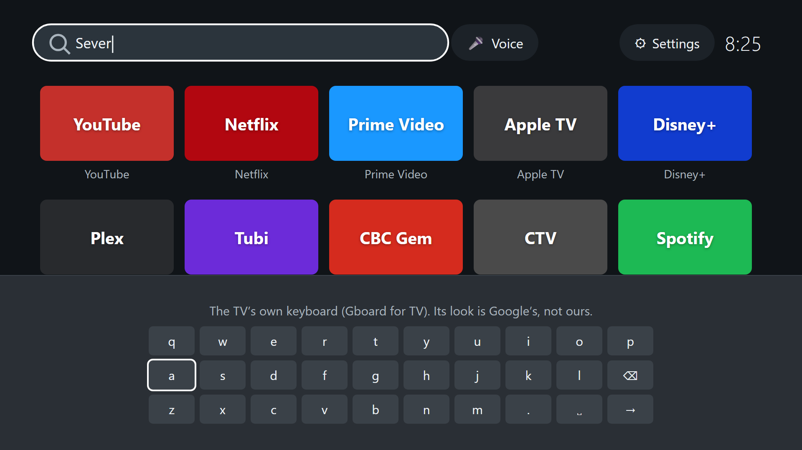
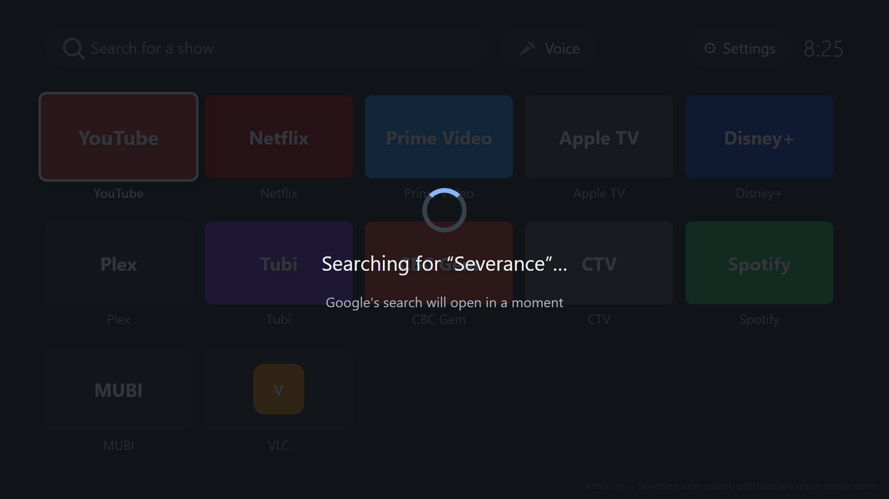
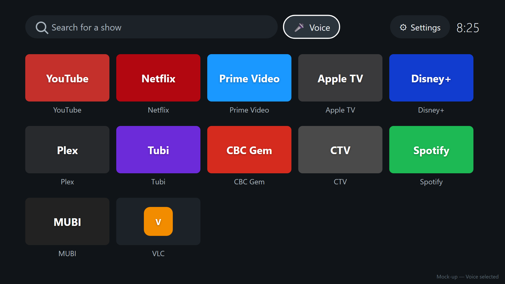
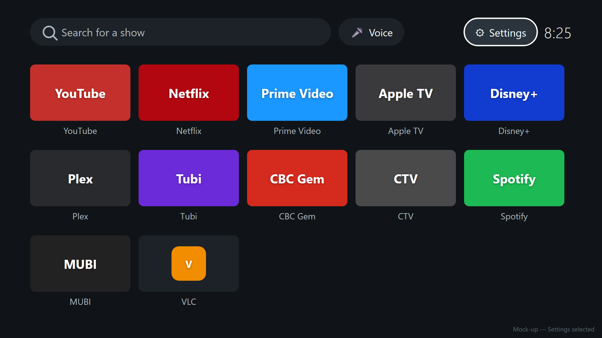
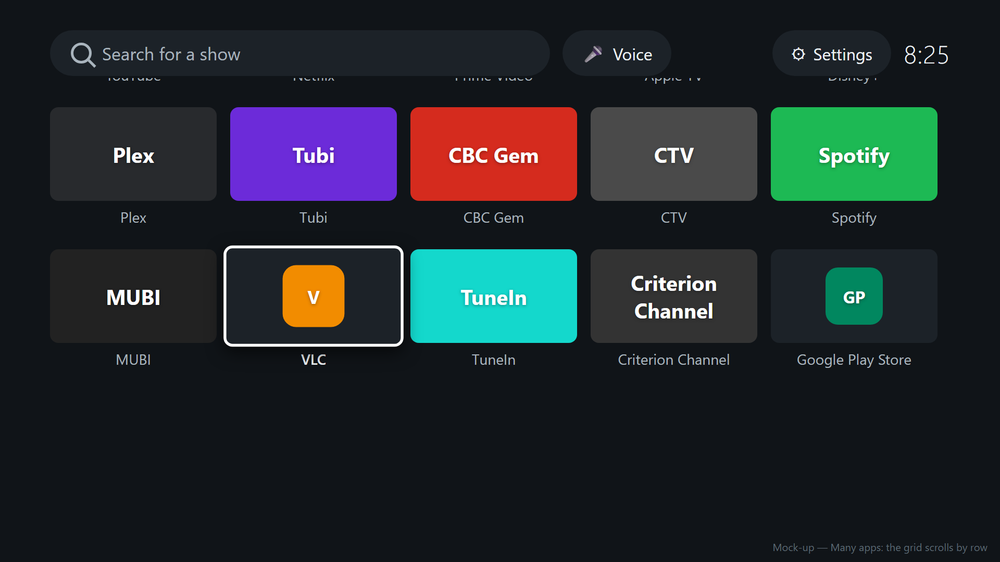
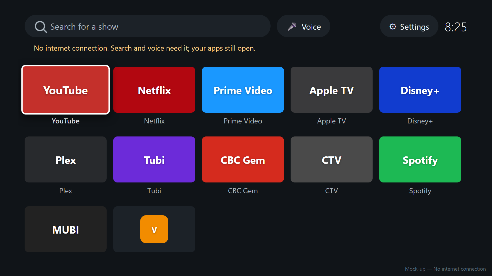
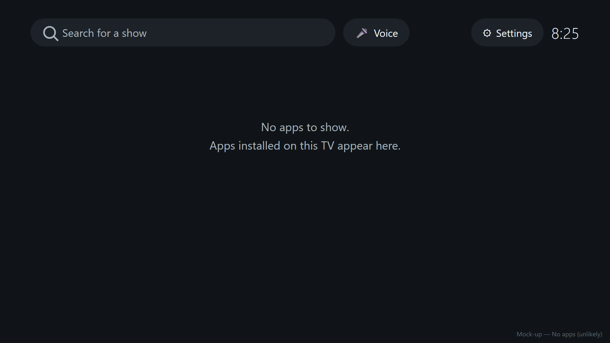

# Home screen design

<!-- docs/design/home-screen.md. The quiet home screen and the search that starts from it. The user
documentation is written from this. Mock-ups: docs/design/home-screen/mockup.html (the source),
rendered to PNG by render.sh. -->

## Personas

- persona-viewer: answers their goals of opening their usual app straight away and finding which
  app has a show, and their frustrations of buried apps, promotion, a screen that keeps changing,
  and having to call the project lead over. Every item has a visible name, so a guest needs no
  explanation.
- persona-setup-person: Settings is one press away from the top row, and new apps appear without
  their help.

## Flow

1. The viewer presses Home, from anywhere. The quiet home screen appears with the first app
   selected.
2. To open an app: move to it with the direction pad and press select.
3. To search: press Up to reach **Search for a show**, press select, type with the TV's keyboard,
   and press its search (enter) key. The screen shows **Searching for "…"** until Google's search
   screen opens; then Google's page for the show appears, naming where to watch it.
4. Back from Google's page or chat reply returns to the quiet home screen, with **Search for a
   show** selected and empty.
5. **Voice** starts Google's voice search; the remote's own voice button works as it always has.
6. **Settings** opens the TV's settings. Home returns to the quiet home screen.

## Mock-ups

Checked against Google TV on a Chromecast with Google TV (Android 14, Cast firmware 3.72). The
keyboard is the TV's own (Gboard for TV); the mock-up only marks where it appears.

| Screen or state | Mock-up | Notes |
|---|---|---|
| Default, first app selected |  | What Home always shows |
| Search box selected |  | One press Up from the first row |
| Typing |  | The TV's keyboard covers the lower half |
| Searching |  | From submit until Google's search screen opens |
| Voice selected |  | |
| Settings selected |  | |
| Many apps, scrolled |  | The grid scrolls a row at a time; the top row stays |
| No internet connection |  | |
| No apps |  | Unlikely; there is always at least the Play Store |

The tiles in the mock-ups are placeholders that show each app's name in a colour; the real screen
shows each app's own banner artwork (VLC and the Play Store show the icon case).

## Layout

- 1920 by 1080, inside the TV safe area (96 px at the sides, 54 px at the top and bottom). Dark,
  plain background; nothing moves on its own.
- **Top row**, left to right: **Search for a show** (a search box), **Voice**, **Settings**, and the
  clock. The clock cannot be selected. The top row stays in place when the apps scroll.
- **Apps**: a grid of five per row, each the app's banner (320 by 180) or, if it has no banner, its
  icon centred on a tile of the same size, with the app's name always shown underneath (cut short
  with an ellipsis if too long). Order: the order the apps were installed, oldest first; apps
  installed at the same moment (preinstalled ones) are in alphabetical order.
- **Selection**: the selected item has a white outline and is slightly enlarged; its name turns
  white and bold. Exactly one item is selected at all times.
- **Movement**: the direction pad moves between neighbours. Up from the first row of apps goes to
  **Search for a show**; Down from the top row goes to the first app. Left and right in the top row
  move between **Search for a show**, **Voice**, and **Settings**. The grid scrolls a row at a time so
  that the selected row is always fully visible.
- **Where selection lands**: Home always shows the screen scrolled to the top with the first app
  selected. Returning with Back from Google's search selects **Search for a show**. Returning from
  an app with Back selects the app that was opened.

## States and errors

- **Searching**: from pressing the keyboard's search key until Google's search screen opens (about
  half a second in the spike), the screen dims and shows a spinner, **Searching for "<text>"…**, and
  **Google's search will open in a moment**. If Google's search has not opened after 10 seconds,
  the message becomes **Google's search did not open. Press Back and try again.** [assumed] Once
  Google's search screen is open, the wait until its page appears (about 4 more seconds in the
  spike) is shown by Google's own screen; what it shows has not been checked.
- **Empty search**: pressing search with nothing typed does nothing.
- **Chat reply**: shown by Google as it is. Back returns home, with the box selected and empty, ready
  to try different text.
- **No internet connection**: a line under the top row, **No internet connection. Search and voice
  need it; your apps still open.** Search and Voice still work as far as Google allows (Google shows
  its own error). The line disappears when the connection returns.
- **No apps**: **No apps to show. Apps installed on this TV appear here.**
- **An app is installed or removed while the screen is showing**: the grid updates in place; the
  selection stays on the same app, or moves to the next one if the selected app was removed.

## How it works

- **Which apps, and their artwork**: the apps Android lists as openable from a TV home screen
  (activities for `MAIN` with the `LEANBACK_LAUNCHER` category), which is the list Google TV's own
  Apps screen shows [assumed], minus this app. Banner and name come from each app. Install time
  comes from Android, so the order survives restarts without storing anything.
- **New and removed apps**: the screen listens for Android's package added and removed broadcasts,
  and also rebuilds the list each time it is shown.
- **"Never shows promotion"**: the app has no internet permission, so it cannot fetch anything; it
  draws only installed apps' own artwork and its own four controls. Checked by a test that fails if
  the built app requests the internet permission, and a screen test that the only items are app
  tiles, the three top-row controls, and the clock.
- **"Pressing Home never shows Google TV's home screen"**: decision-home-takeover. Checked by the
  screen-recording test in story-quiet-home-home-key, and by tests of the service's rule: the Home
  key is consumed, Google TV's home screen window brings the quiet one forward, and no other window
  or key does anything.
- **Search**: the text is sent unchanged to Google's search (`GLOBAL_SEARCH` with a `query`, as in
  the spike), and the box is cleared as it is sent. **Voice** sends the same request with no text,
  which opens Google's voice search.
- **Back from Google's search**: Google's screens sit on top of the quiet home screen, so Back
  returns to it (seen in the spike).
- **Settings**: opens the TV's settings app (Android's main settings screen), which is where
  Google TV's settings icon leads.
- **Clock**: the system clock, which follows the TV's time zone and 12- or 24-hour setting.
- **No internet connection**: Android's connectivity status, updated as it changes.
- **Same for every profile**: nothing is stored per profile; the list comes from what is installed.

## Accessibility

- Everything is reachable with the direction pad, select, back, and home; nothing needs a pointer.
- The selection outline is white on a dark background and does not rely on colour alone (it also
  enlarges the item and bolds its name).
- Text is at least 28 px at 1080p, readable from the couch; names are always shown, not only on
  selection.
- With the TV's screen reader (TalkBack) on, each item reads its name and role: "YouTube, app",
  "Search for a show, search box", "Voice, button", "Settings, button"; the clock reads the time.
- The only motion is the selection enlarging and the spinner while searching; with the TV's
  "remove animations" setting on, neither animates.
